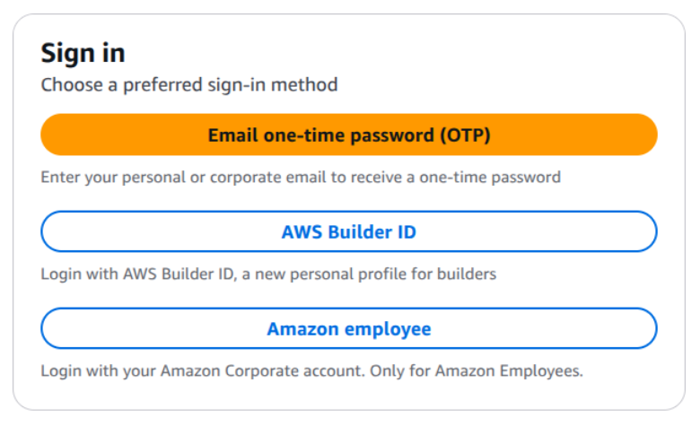
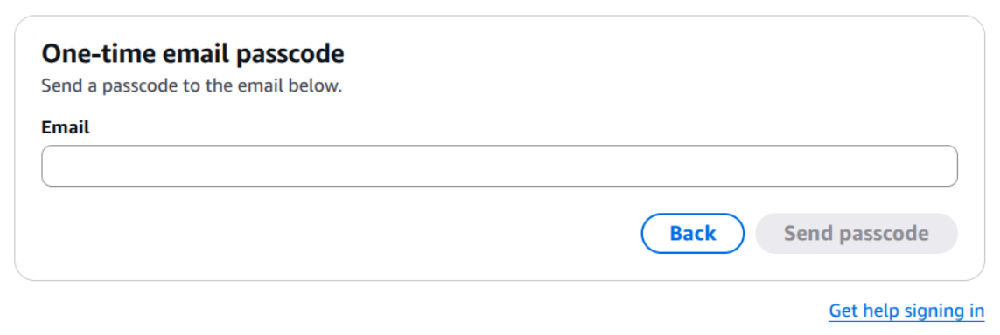
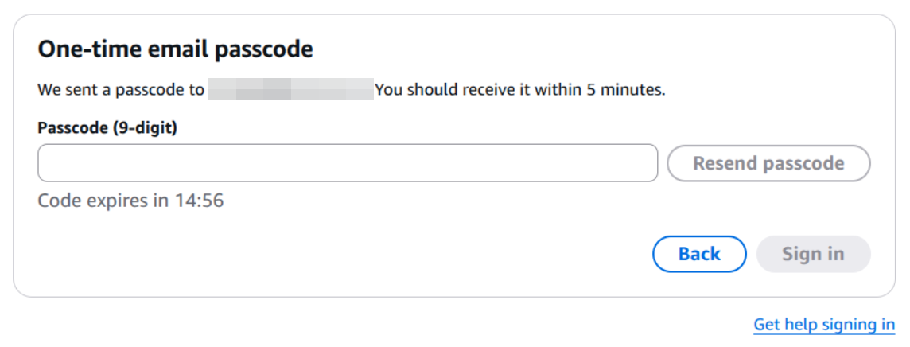
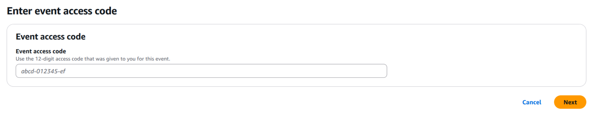

# From Data to Evidence with Research Agents: Hands-on Vibe-coding Workshop

SIIM-CAIMI 2026 workshop with Dr. Peter Chang and Dr. Steven Rothenberg

| | |
|---|---|
| **Session** | 2004 |
| **Date** | Tuesday, October 27th, 2026 |
| **Time** | 12:30-2:00 pm ET |
| **Location** | Arthur H. Rubenstein Auditorium, University of Pennsylvania, Philadelphia, PA |
| **Program page** | [SIIM-CAIMI program schedule](https://siim.org/caimi/program-schedule/from-data-to-evidence-with-research-agents-hands-on-vibe-coding-workshop/) |

This is a hands-on, build-along workshop, not a lecture. Using **Kiro CLI** and **Amazon Bedrock**, you will direct a coding
agent through a connected research workflow on chest radiographs: explore an unfamiliar image collection, find and fix
data problems, build an analysis cohort, evaluate pretrained pneumothorax detectors, and write up the result, while
reviewing the agent's work and keeping human judgment, validation, and reproducibility at the center. The session also
shows how model output can be carried into a live PaxeraHealth PACS viewing environment (demonstrated by the instructors;
nothing to set up for it).

## Resources

- **Workshop materials:** [agent-ai-skills](https://github.com/peterchang77/agent-ai-skills) ([website](https://peterchang77.github.io/agent-ai-skills/)). This workshop uses the [Imaging demo](https://peterchang77.github.io/agent-ai-skills/demo-imaging/) and [Imaging tutorial](https://peterchang77.github.io/agent-ai-skills/tutorial-imaging/), plus the concept pages for background reading.
- **Data:** a public sample of 250 chest radiographs (SIIM pneumothorax sample, 33 MB, downloaded during setup), with synthetic reports and
  clinical fields added by the workshop. Everything is public or synthetic.

## Set up your environment before the workshop

Your workshop environment is provided through **AWS Workshop Studio**: a temporary AWS account with **Kiro IDE (web)** that runs in your
browser, so nothing needs to be installed on your laptop and no Kiro sign-in is needed. The workshop files are already in place.
Prefer your own machine? See [Option 2: personal device](#option-2-personal-device).

You will be given an **event access code** at the workshop, and it is required for setup, so complete these steps when you arrive.

### Quick start

You need: any email address you can read during the session (personal or institutional), the event access code, and a normal
Chrome, Edge, Firefox, or Safari window.

1. Open [https://catalog.us-east-1.prod.workshops.aws/join](https://catalog.us-east-1.prod.workshops.aws/join), choose **Email one-time password (OTP)**, enter the passcode emailed to you,
   then enter the **event access code**.
2. Open **Kiro IDE (web)** from the event page, then open a terminal (**Terminal** > **New Terminal**).
3. In the terminal, start the agent:

   ```bash
   cd ~/workshop-imaging
   kiro-cli
   ```

If something goes wrong, see [Troubleshooting](#troubleshooting). Your AWS account is temporary: it lasts 72 hours, and its files are deleted afterward.

### Detailed steps

#### Before you start

- Use a normal browser window, and an email address you can open right now (the sign-in passcode is sent to it).
- You do not need your own AWS account, billing, or a credit card.
- Only use the workshop's public and synthetic data in this environment. Do not upload patient data or other regulated or institutional data.

#### Step 1. Sign in to AWS Workshop Studio

Open [https://catalog.us-east-1.prod.workshops.aws/join](https://catalog.us-east-1.prod.workshops.aws/join). Choose **Email one-time password (OTP)**.



Enter your email address to have a one-time passcode sent to you.



Open the email and enter the 9-digit passcode (it arrives within 5 minutes and expires after 15), then click **Sign in**.



Enter the **event access code** given to you at the workshop and continue.



#### Step 2. Open Kiro IDE and a terminal

From the event page, open **Kiro IDE (web)**. It can take a minute to load. Then open a terminal from the menu: **Terminal** > **New Terminal**.

To paste into the terminal, use **Ctrl+Shift+V** (**Cmd+V** on a Mac), or right-click and choose Paste.

Confirm the workshop files are there:

```bash
cd ~/workshop-imaging
pwd    # /home/<your-name>/workshop-imaging
ls     # the workshop files
```

#### Step 3. Start the agent

Kiro CLI is already set up for this environment, so you do not need to sign in. Run:

```bash
kiro-cli
```

Try a simple request such as _"What files are in this folder?"_. If it answers, you are ready for the workshop.

#### When you are done

- Copy anything you want to keep out of the environment first (right-click a file in the Kiro IDE file explorer and choose Download). Your files are deleted when the AWS account expires.
- The account is available for 72 hours. After that, you will need a new event access code to use it again.

### Troubleshooting

| Problem | What to try |
|---|---|
| I did not receive the passcode email | Check your spam folder and wait a few minutes, then click **Resend passcode**. Make sure the address was typed correctly. |
| The passcode does not work or has expired | Codes expire after 15 minutes. Click **Back**, request a new passcode, and use the newest email. |
| The event access code is rejected | Enter it exactly as given, with no extra spaces. If it still fails, ask a helper. |
| The Kiro IDE page does not load | Use a normal, non-incognito window, wait a minute, and refresh. Try another browser if it persists. |
| `cd ~/workshop-imaging` fails | Run `ls ~` to look for the workshop folder, or ask a helper. |
| `kiro-cli: command not found` | Run `source ~/.bashrc` or `export PATH="$HOME/.local/bin:$PATH"`, then try again. |
| The environment has expired | The account lasts 72 hours. Ask a helper for a new event access code. |

Still stuck? Ask a helper in the room. Bring your laptop, and we can set up the alternative below.

### Option 2: personal device

If you cannot use AWS Workshop Studio, you can install the same materials and Kiro CLI on your own computer with the
installer from the [workshop materials](https://peterchang77.github.io/agent-ai-skills/tutorial-imaging/setup/) (macOS, Linux, Windows via WSL, or native Windows PowerShell).

macOS, Linux, or Windows via WSL:

```bash
curl -fsSL https://peterchang77.github.io/agent-ai-skills/install.sh | bash -s -- --scenario imaging
```

Windows PowerShell:

```powershell
& ([scriptblock]::Create((irm https://peterchang77.github.io/agent-ai-skills/install.ps1))) -Scenario imaging
```

Then run `kiro-cli login` and `kiro-cli` from `~/workshop-imaging` (`$HOME\workshop-imaging` on Windows). On your own machine Kiro CLI does need a sign-in: run `kiro-cli login`, choose a method such as **Use with Google**, and follow the prompts
(a browser may open automatically).
