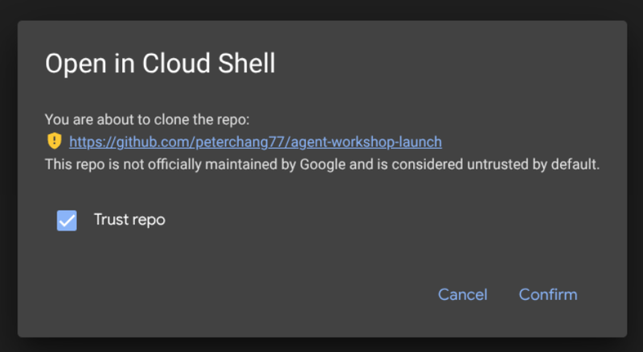
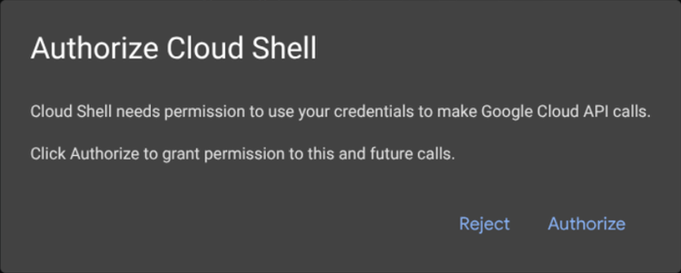
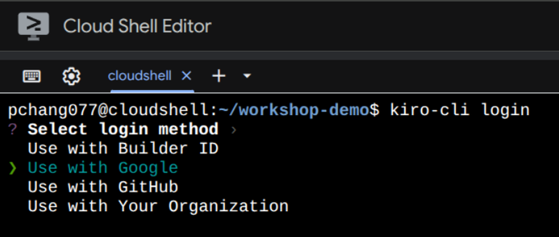
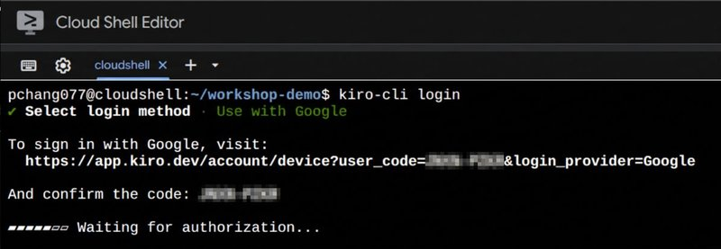
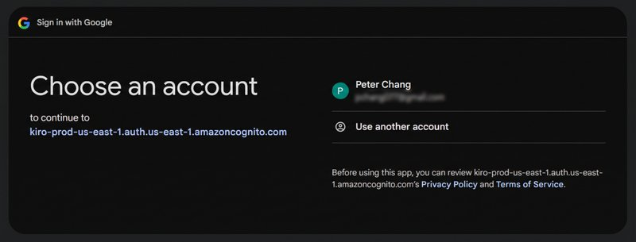
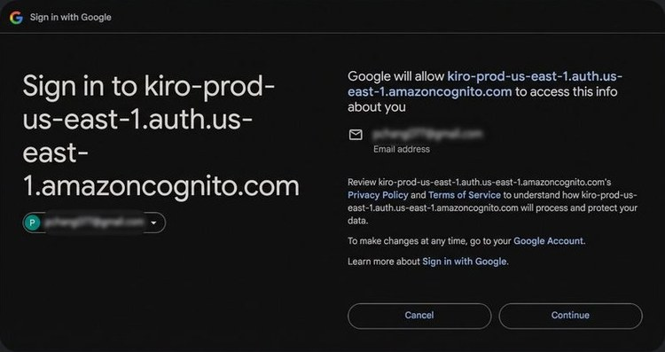
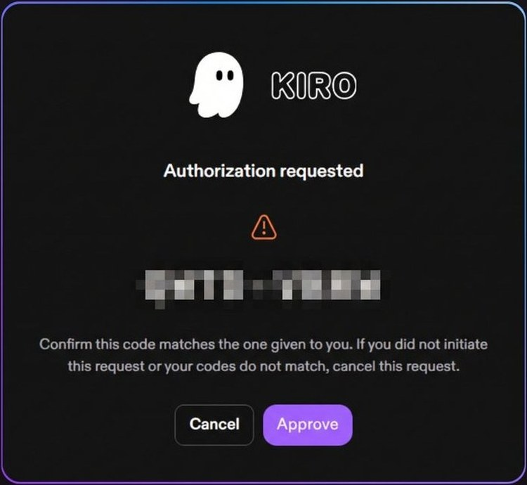

# From Data to Evidence with Research Agents: Hands-on Vibe-coding Workshop

SIIM-CAIMI 2026 workshop with Dr. Peter Chang and Dr. Steven Rothenberg

| | |
|---|---|
| **Session** | 2004 |
| **Date** | Tuesday, October 27th, 2026 |
| **Time** | 12:30-2:00 pm ET |
| **Location** | Arthur H. Rubenstein Auditorium, University of Pennsylvania, Philadelphia, PA |
| **Program page** | [SIIM-CAIMI program schedule](https://siim.org/caimi/program-schedule/from-data-to-evidence-with-research-agents-hands-on-vibe-coding-workshop/) |

This is a hands-on, build-along workshop, not a lecture. Using **Kiro CLI** and **Amazon Bedrock**, you will direct a coding
agent through a connected research workflow on chest radiographs: explore an unfamiliar image collection, find and fix
data problems, build an analysis cohort, evaluate pretrained pneumothorax detectors, and write up the result, while
reviewing the agent's work and keeping human judgment, validation, and reproducibility at the center. The session also
shows how model output can be carried into a live PaxeraHealth PACS viewing environment (demonstrated by the instructors;
nothing to set up for it).

## Resources

- **Workshop materials:** [agent-ai-skills](https://github.com/peterchang77/agent-ai-skills) ([website](https://peterchang77.github.io/agent-ai-skills/)). This workshop uses the [Imaging demo](https://peterchang77.github.io/agent-ai-skills/demo-imaging/) and [Imaging tutorial](https://peterchang77.github.io/agent-ai-skills/tutorial-imaging/), plus the concept pages for background reading.
- **Data:** a public sample of 250 chest radiographs (SIIM pneumothorax sample, 33 MB, downloaded during setup), with synthetic reports and
  clinical fields added by the workshop. Everything is public or synthetic.

## Set up your environment before the workshop

Please complete this once before you arrive, so we can spend the session on the exercises. It takes about 10 minutes (the image data is prepared on your session).
You will use **Google Cloud Shell**, a free Linux terminal that runs in your web browser, so nothing needs to be installed
on your laptop. Prefer your own machine? See [Option 2: personal device](#option-2-personal-device).

### Quick start

You need: a **personal Google account** (such as Gmail; institutional accounts are often blocked), and a normal
(non-incognito) Chrome, Edge, Firefox, or Safari window.

1. Click this link and accept both dialogs (**Confirm**, then **Authorize**):

   **[Launch the workshop environment](https://shell.cloud.google.com/cloudshell/editor?cloudshell_git_repo=https://github.com/peterchang77/agent-workshop-launch&cloudshell_print=START.txt&cloudshell_workspace=workshops/siim-caimi-2026&ephemeral=true&show=terminal)**

2. In the terminal, run:

   ```bash
   source go.sh
   ```

3. Sign in to Kiro:

   ```bash
   kiro-cli login
   ```

   Choose **Use with Google**, open the URL shown in any browser, choose your Google account, and click **Approve**.

4. Start the agent:

   ```bash
   kiro-cli
   ```

If something goes wrong, see [Troubleshooting](#troubleshooting). Your session is temporary: its files are deleted when it ends.

### Detailed steps

#### Before you start

- Use a **personal Google account**. Cloud Shell is not available to accounts under 18 or of unknown age, and Google
  Workspace for Education accounts (often school or university accounts) are blocked by default.
- Use a normal browser window. Private or incognito windows block third-party cookies, which the Cloud Shell editor needs.
- You do not need a Google Cloud project, billing, or a credit card.
- Only use the workshop's public and synthetic data in Cloud Shell. Do not upload patient data or other regulated or institutional data.

#### Step 1. Launch Cloud Shell

Click the launch link above. A dialog asks you to confirm opening the workshop repository in Cloud Shell. Click **Confirm**.



Next, Cloud Shell asks permission to make Google Cloud API calls with your credentials. Click **Authorize**.



The first launch can take up to about 30 seconds while the terminal starts. When it is ready, a short set of
instructions is printed in the terminal.

#### Step 2. Install the workshop files and Kiro

In the terminal, run:

```bash
source go.sh
```

Use `source` and not `bash`: it lets the script add Kiro to your PATH and move you into the project folder. This takes a few minutes
(it installs the Python tool `uv`, downloads a 33 MB public image sample, and prepares the files). Expect lines such as "Building the image kit" and "imaging-kit: ... added" and a note from the Kiro installer about updating your PATH
(the script handles that for you). When it finishes you are in `~/workshop-imaging`; confirm with:

```bash
pwd    # /home/<your-name>/workshop-imaging
ls     # the workshop files
```

To paste into the terminal, use **Ctrl+Shift+V** (**Cmd+V** on a Mac), or right-click and choose Paste.

#### Step 3. Sign in to Kiro

Run:

```bash
kiro-cli login
```

Choose **Use with Google** with the arrow keys and press Enter.



The terminal prints a login URL and then waits for you. Cloud Shell cannot open a browser itself, so open the URL
yourself in any browser (a new tab, or your phone). The URL already includes your one-time code.



Choose your Google account.



Google then explains that it will let Kiro see one piece of information about you: your email address. Click **Continue**.



The Kiro page shows an authorization code. Check that it matches the code in your terminal, then click **Approve**.



Return to the terminal. It detects the sign-in on its own and you can continue.

#### Step 4. Start the agent

```bash
kiro-cli
```

Try a simple request such as _"What files are in this folder?"_. If it answers, you are ready for the workshop.

#### When you are done

- Copy anything you want to keep out of Cloud Shell first (right-click a file in the editor and choose Download). This is a
  temporary session and its files are deleted when it ends.
- Closing the browser tab does not end the session immediately, and typing `exit` only closes the shell. The VM is discarded
  after it has been idle for a while (Google's documentation gives both 40 minutes and one hour).
  To end it sooner, open the Cloud Shell menu, choose **More**, then **Restart**.
- To see your weekly usage, click **Session information** then **Usage quota**. The free quota is 50 hours a week.

### Troubleshooting

| Problem | What to try |
|---|---|
| Cloud Shell says it is unavailable or blocked | You are probably signed in with a school or work account, or one Google cannot confirm is 18 or older. Sign out and use a personal Gmail account (try a fresh browser profile). |
| The editor or terminal does not load | Use a normal, non-incognito window and allow third-party cookies for the page, or click **Open in New Window** in the editor. |
| No instructions were printed in the terminal | Run `ls`. If you see `go.sh`, continue with `source go.sh`. If not, close the tab and click the launch link again. |
| `source: go.sh: file not found` | You are in the wrong folder. Run `cd ~/cloudshell_open/agent-workshop-launch-0/workshops/siim-caimi-2026` (the number may differ; press Tab to complete), then try again. |
| `kiro-cli: command not found` | Run `source ~/.bashrc` or `export PATH="$HOME/.local/bin:$PATH"`, then try again. |
| The install fails or hangs | Check your connection and run `source go.sh` again. It is safe to rerun and skips files it already has. |
| The login code or URL does not work | Codes expire after a few minutes. Press Ctrl+C and run `kiro-cli login` again for a new one. |
| The terminal says "not logged in" after approving | Wait a few seconds, then run `kiro-cli login` again. If the problem continues, ask a helper. |
| Cloud Shell stopped after a break | Sessions time out when idle. Click the launch link again and rerun `source go.sh`; your files are re-created. |

Still stuck? Ask a helper in the room. Bring your laptop, and we can set up the alternative below.

### Option 2: personal device

If you cannot use Cloud Shell, you can install the same materials and Kiro CLI on your own computer with the
installer from the [workshop materials](https://peterchang77.github.io/agent-ai-skills/tutorial-imaging/setup/) (macOS, Linux, Windows via WSL, or native Windows PowerShell).

macOS, Linux, or Windows via WSL:

```bash
curl -fsSL https://peterchang77.github.io/agent-ai-skills/install.sh | bash -s -- --scenario imaging
```

Windows PowerShell:

```powershell
& ([scriptblock]::Create((irm https://peterchang77.github.io/agent-ai-skills/install.ps1))) -Scenario imaging
```

Then run `kiro-cli login` and `kiro-cli` from `~/workshop-imaging` (`$HOME\workshop-imaging` on Windows). The sign-in steps are the same as in Step 3,
except that a browser may open automatically and you won't need to copy the URL.
